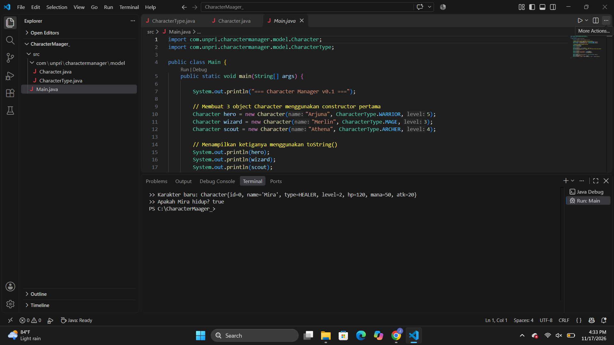
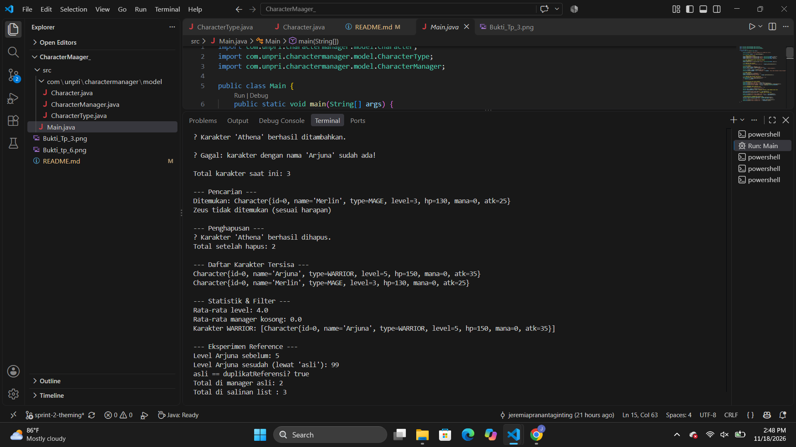
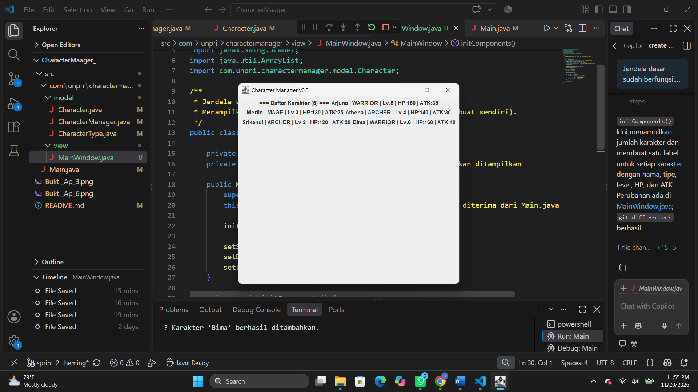

## AP3 - Character Manager (Java Visual SIH-6406)
Aplikasi ini adalah sistem manajemen karakter sederhana berbasis teks (Console-based Game Character Manager) yang dibangun menggunakan bahasa pemrograman Java. Proyek ini menerapkan prinsip Pemrograman Berorientasi Objek (OOP), khususnya enkapsulasi (Encapsulation) dengan pembatasan hak akses atribut menggunakan setter, getter, serta fungsi validasi nilai logika. Sistem juga mendukung kalkulasi otomatis status karakter (HP dan Attack) berdasarkan level serta fitur pelacakan kondisi hidup/mati karakter.

### Screenshot Output Terminal ap3
Screenshot ini mendokumentasikan demo sebelumnya yang menampilkan hasil `isAlive()`. `Main.java` sekarang menjalankan demo CRUD v0.2.

![Screenshot output terminal Character Manager] 

## Struktur Project
Struktur Folder Project

CharacterMaager_/
├── src/
│   ├── Main.java
│   └── com/
│       └── unpri/
│           └── charactermanager/
│               │── model/
│               │   ├── Character.java
│               │   │── CharacterType.java
│               │   └── CharacterManager.java
│               └── view/
│                   └── MainWindow.java
│                   
│              
├── Bukti_Ap_3.png
│── Bukti_Ap_6.png
├── Bukti_Ap_10.png
└── README.md

## AP6 - Fitur Baru: Pencarian Karakter Terkuat (findStrongest)

1. Rasional / Alasan Fitur
Dalam pengembangan sebuah game atau sistem RPG, mengetahui entitas atau karakter mana yang memiliki statistik tertinggi (terkuat) merupakan fitur analisis data yang sangat krusial. Fitur findStrongest() ditambahkan untuk mempermudah sistem dalam menyaring karakter dengan daya serang (attackPower) paling mendominasi tanpa mengharuskan layer aplikasi melakukan pengurutan (sorting) manual di sisi luar.

2. Menjaga Prinsip OOP & Enkapsulasi
Defensive Design: Method mengembalikan satu objek Character tunggal atau nilai null apabila sistem belum memiliki data karakter sama sekali.
No Information Leakage: Struktur data internal ArrayList<Character> characterList milik CharacterManager tetap terkunci rapat di dalam class (private). Akses luar murni hanya mendapatkan hasil kalkulasi/pencarian objek spesifik tanpa diberi celah untuk memodifikasi atau menambah isi list secara ilegal.
### Screenshot Output Terminal ap6

## AP10 — Character Manager GUI dan Statistik Karakter
1. Aliran Data dan Penerapan MVC
Aliran data aplikasi dimulai dari Main.java, yang membuat objek Character dan menambahkan data karakter ke CharacterManager. Selanjutnya, Main.java mengambil daftar karakter melalui method getAllCharacters() dan mengirimkannya ke MainWindow untuk ditampilkan dalam antarmuka Java Swing. Dalam konsep MVC, package model bertanggung jawab terhadap data dan logika karakter, sedangkan MainWindow berperan sebagai bagian View yang menampilkan data kepada pengguna. Main.java mengatur proses inisialisasi dan menghubungkan Model dengan View, sementara statistik rata-rata level dihitung berdasarkan daftar karakter yang diterima oleh View.

2. Karakter Baru dan Alasan Pemilihan Tipe/Level
Dua karakter baru ditambahkan untuk memenuhi kebutuhan minimal lima karakter sekaligus memberikan variasi tipe dan level pada aplikasi. Srikandi — ARCHER, Level 2: Dipilih sebagai karakter pemanah dengan level awal yang relatif rendah untuk menunjukkan variasi statistik pada karakter yang masih berkembang. Bima — WARRIOR, Level 6: Dipilih sebagai karakter petarung dengan level lebih tinggi untuk memberikan perbandingan statistik dengan karakter berlevel rendah serta membantu menguji perhitungan rata-rata level. Penambahan karakter dengan tipe dan level yang berbeda memungkinkan aplikasi menampilkan data yang lebih bervariasi dan menguji apakah statistik rata-rata level dihitung berdasarkan seluruh karakter secara akurat.
### Screenshot Output Terminal ap10

## Identitas Mahasiswa

Nama: Jeremia Prananta Ginting
NIM : 253303621201
Link Google Docs ap3 :
Link Google Docs ap6 :
Link Google Docs ap10:https://docs.google.com/document/d/1jHux_H1N2GJDQ0PjGE_Viuxbh4arjsCe6VSF1TeBf5g/edit?usp=sharing
