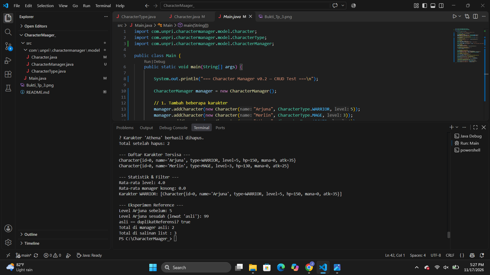

## AP3 - Character Manager (Java Visual SIH-6406)
Aplikasi ini adalah sistem manajemen karakter sederhana berbasis teks (Console-based Game Character Manager) yang dibangun menggunakan bahasa pemrograman Java. Proyek ini menerapkan prinsip Pemrograman Berorientasi Objek (OOP), khususnya enkapsulasi (Encapsulation) dengan pembatasan hak akses atribut menggunakan setter, getter, serta fungsi validasi nilai logika. Sistem juga mendukung kalkulasi otomatis status karakter (HP dan Attack) berdasarkan level serta fitur pelacakan kondisi hidup/mati karakter.

### Screenshot Output Terminal ap3
Screenshot ini mendokumentasikan demo sebelumnya yang menampilkan hasil `isAlive()`. `Main.java` sekarang menjalankan demo CRUD v0.2.

## Struktur Project
Struktur Folder Project

CharacterMaager_/
├── src/
│   ├── Main.java
│   └── com/
│       └── unpri/
│           └── charactermanager/
│               └── model/
│                   ├── Character.java
│                   ├── CharacterManager.java
│                   └── CharacterType.java
├── Bukti_Tp_3.png
│── Bukti_Tp_6.png
└── README.md

## AP6 - Fitur Baru: Pencarian Karakter Terkuat (findStrongest)

1. Rasional / Alasan Fitur
Dalam pengembangan sebuah game atau sistem RPG, mengetahui entitas atau karakter mana yang memiliki statistik tertinggi (terkuat) merupakan fitur analisis data yang sangat krusial. Fitur findStrongest() ditambahkan untuk mempermudah sistem dalam menyaring karakter dengan daya serang (attackPower) paling mendominasi tanpa mengharuskan layer aplikasi melakukan pengurutan (sorting) manual di sisi luar.

2. Menjaga Prinsip OOP & Enkapsulasi
Defensive Design: Method mengembalikan satu objek Character tunggal atau nilai null apabila sistem belum memiliki data karakter sama sekali.
No Information Leakage: Struktur data internal ArrayList<Character> characterList milik CharacterManager tetap terkunci rapat di dalam class (private). Akses luar murni hanya mendapatkan hasil kalkulasi/pencarian objek spesifik tanpa diberi celah untuk memodifikasi atau menambah isi list secara ilegal.
### Screenshot Output Terminal ap6

## Identitas

- Nama: Jeremia Prannanta
- NIM: 253303621201
- Analisis Bagian D (Google Docs): tautan belum tersedia; tambahkan setelah dokumen dibuat.

